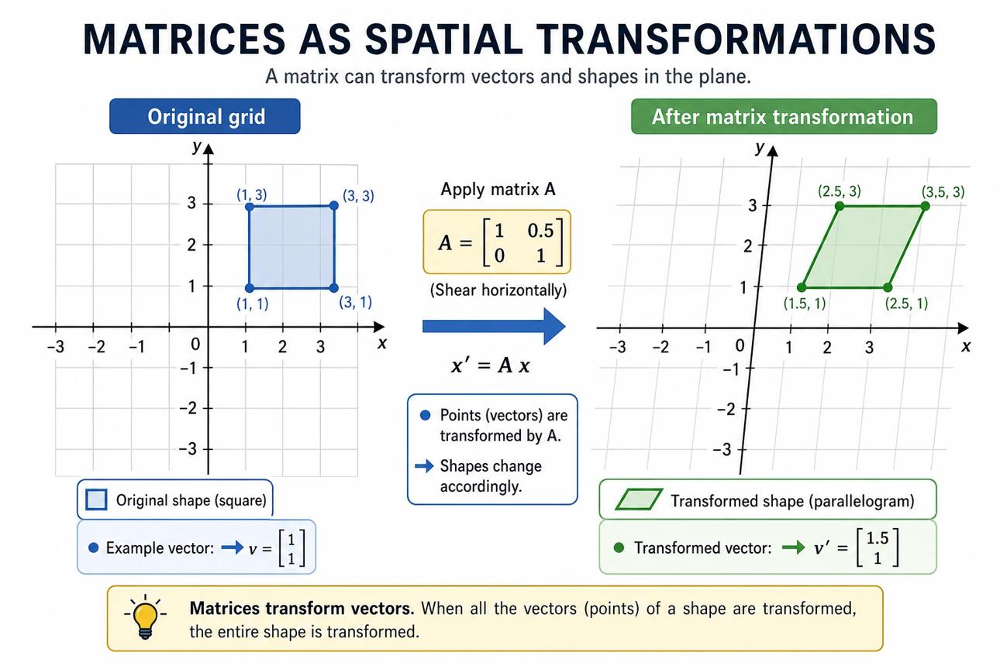
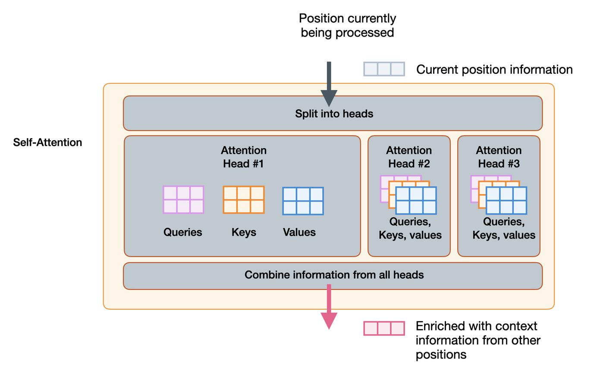
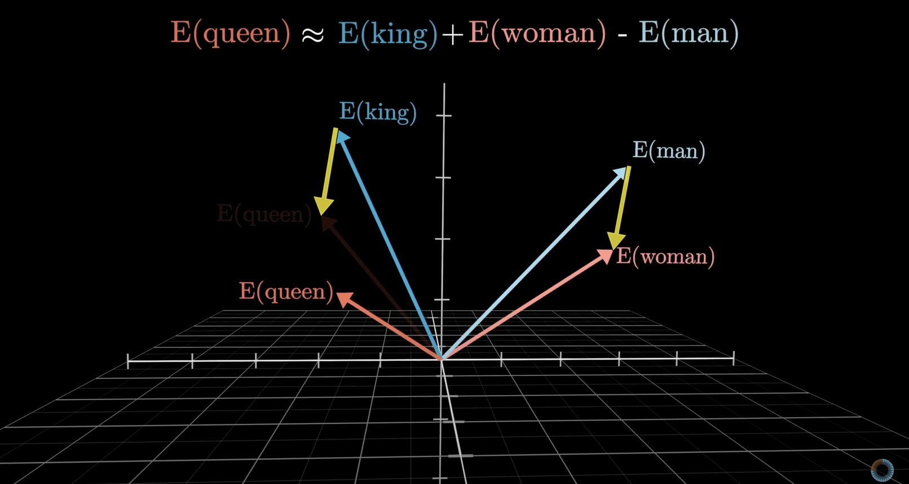
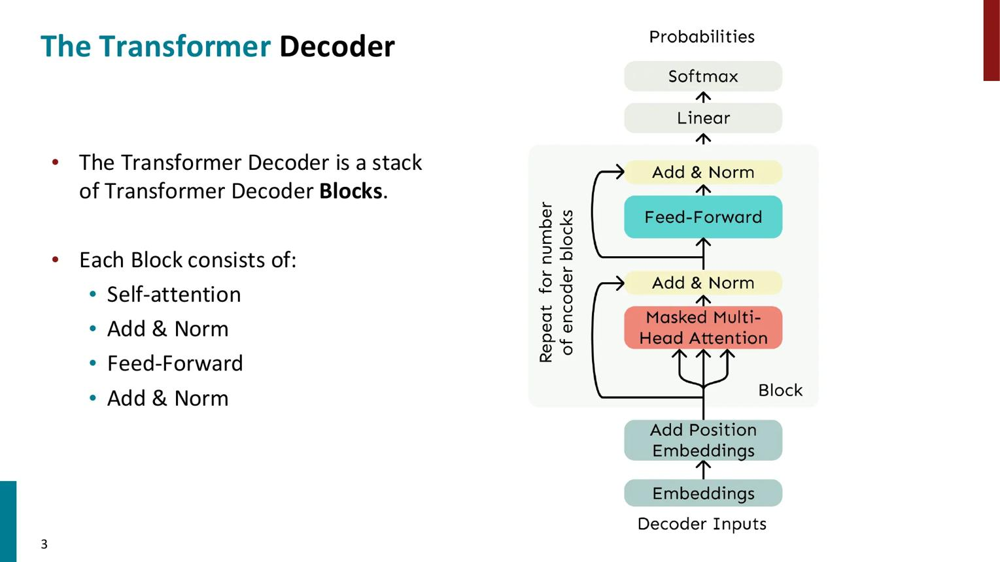
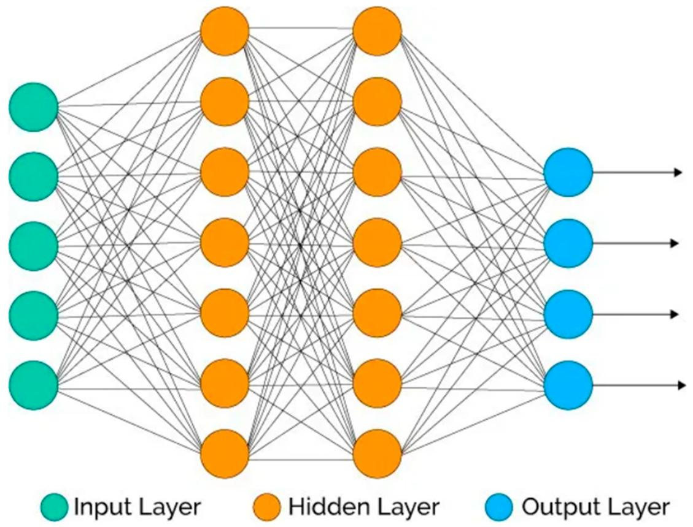
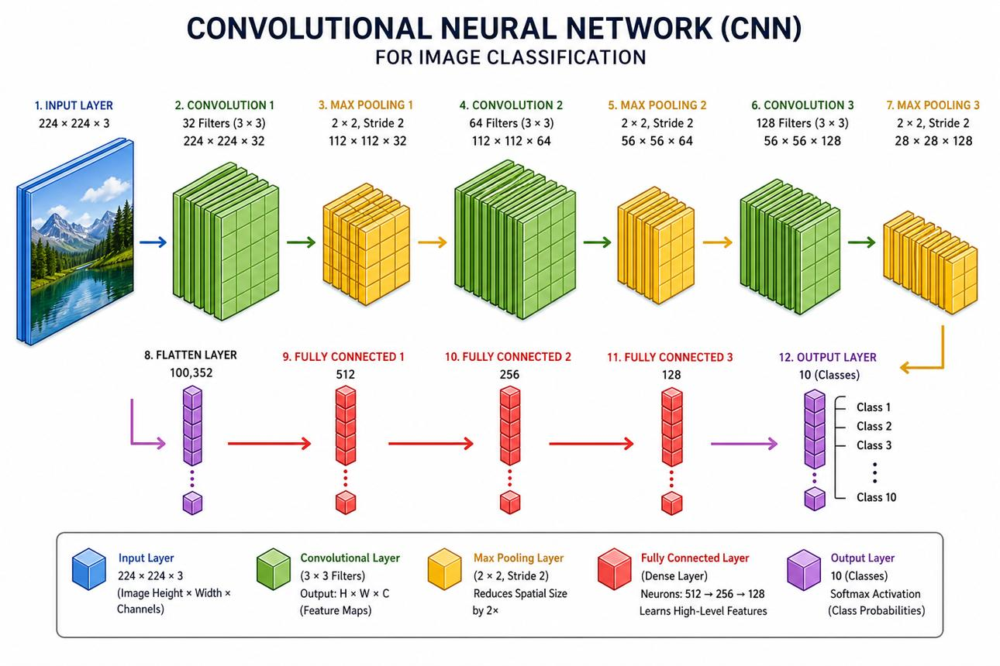
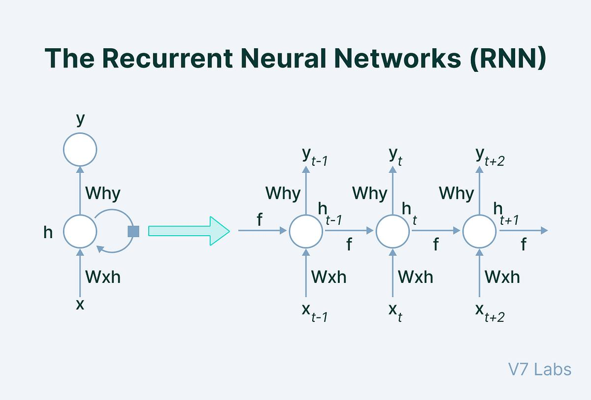
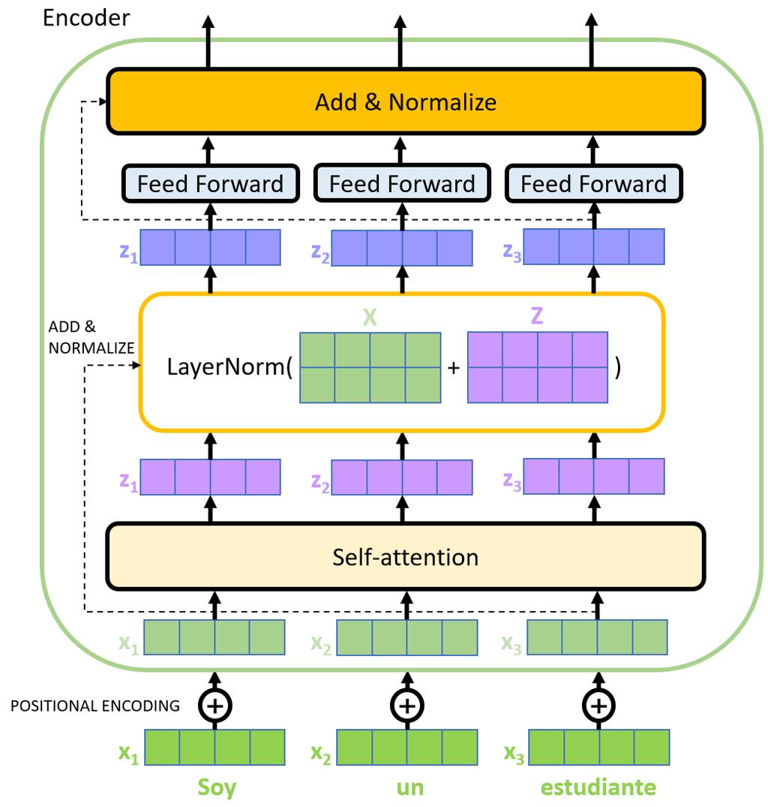

# Transformers in Large Language Models and Explicit Relation Lookup

What if answering “What is the opposite of hot?” took one vector transformation and one index lookup? Once the request identifies *hot* in the temperature sense and selects the *opposite* relation, the system could retrieve the coordinates of *hot*, reflect them along a temperature axis, and look up the closest suitable concept. In a space where that relation is represented explicitly, the result would be *cold*.

```text
hot (temperature)  →  look up its vector  →  apply opposite
                   →  retrieve near the resulting coordinates  →  cold
```

This is a hypothesis about replacing a Transformer call for a well-defined task. It depends on what the representation captures, how the relation is chosen, and whether retrieval returns the intended concept. A ChatGPT conversation captured on 19 November 2026 provides the background examples.

## From hot to cold

1. **Resolve the input.** Find a stable concept identifier and a vector for the intended sense of *hot*. The temperature sense calls for a different operator or candidate set than *hot* in “a hot topic.”
2. **Select the relation.** In this example the caller supplies *opposite* and the relevant axis is temperature. A natural-language interface would also have to resolve these from the question or ask for context.
3. **Transform the coordinates.** Suppose a teaching example gives *hot* the coordinates $(2,1)$, where the first coordinate measures temperature relative to a neutral point and the second records an unrelated feature. Reflecting the temperature coordinate sends $(2,1)$ to $(-2,1)$ while preserving the second coordinate.
4. **Retrieve the answer.** If *cold* is indexed at $(-2,1)$, an exact lookup suffices in this example. If the transformed point lands between indexed concepts, rank nearby candidates. The index can filter to the correct domain and use a declared ranking bias to favor a preferred term among otherwise plausible hits.

A retrieval score could be $\operatorname{sim}(q,v_c)+\beta(c)$, where $q$ is the transformed query, $v_c$ is a candidate vector, and $\beta(c)$ is a ranking adjustment such as a preference for the canonical label in the requested language. The observed distance, ranking adjustment, and acceptance threshold can be reported separately. If two distinct senses remain plausible or all eligible candidates fall outside the accepted distance, the result can preserve ambiguity or report that the relation is unsupported. A test should also remove the ranking adjustment to show whether the geometry itself retrieves *cold*.

## What a weight matrix does

A vector gives the coordinates of a point in a representation space. A matrix specifies how to map the vector into an output space, which can have different axes or dimensions. In the affine map $y=Wx+b$, $x$ is the starting vector, $W$ defines the linear transformation, and $b$ shifts the result. This mathematical bias belongs to the transformation. The retrieval bias above changes candidate ranking after the transformation.

For example, with zero bias, the matrix below doubles the first coordinate and triples the second.

$$
W=\begin{bmatrix}2&0\\0&3\end{bmatrix},
\qquad
x=\begin{bmatrix}1\\2\end{bmatrix},
\qquad
y=\begin{bmatrix}2\\6\end{bmatrix}
$$

In a trained network, the entries of $W$ are learned parameters. The matrix determines what happens to the coordinates when the layer operates on an input. The vector $y$ is the result of that operation in the output space.



[AI Roads · Matrices](https://airoads.org/ch04-ai-math/ch01-linear-algebra/02-matrices/?utm_source=chatgpt.com)

### Equality, inversion, and relation types

In a toy space centered at zero, equality with oneself can be expressed as identity, $f(x)=x$. Full inversion is $g(x)=-x$. In two dimensions the second matrix is the negative of the first.

$$
W_{\text{equal}}=\begin{bmatrix}1&0\\0&1\end{bmatrix},
\qquad
W_{\text{opposite}}=\begin{bmatrix}-1&0\\0&-1\end{bmatrix}
$$

Both operations can use the same indexed representation. If $W_{\text{equal}}=I$, the shared computation $Ix$ can be followed by either keeping its sign or reversing it. A neural architecture can express such choices with different weights or by applying a different function to a shared transformation. The identity map returns the original vector. Retrieving another word with the same meaning requires a representation or index that captures that relationship.

The temperature example uses a narrower inversion. It can be written as a reflection around a midpoint $m$ along a unit axis $u$. The term $u^\top(x-m)$ measures how far the point lies along that axis. Subtracting twice that component reverses its sign around $m$.

$$
T_{\text{opposite}}(x)=x-2u\,u^\top(x-m)
$$

*Hot ↔ cold*, *up ↔ down*, and *good ↔ bad* each require a relevant dimension and a sense. Up and down depend on a reference frame. Judgments of good and bad depend on the criterion being applied. Learned embeddings can also place antonyms and synonyms near one another because both occur in similar contexts. A full sign flip around the origin only implements the intended relation in a space with suitable geometry. [Nguyen, Schulte im Walde, and Vu · Integrating Distributional Lexical Contrast into Word Embeddings](https://aclanthology.org/P16-2074/)

This suggests an architecture built from a collection of reusable functions for different kinds of relations. A function might preserve some coordinates, change others, or map between two spaces. A task can select one function or compose several when their meanings and input and output spaces agree. For example, a reflection applied twice should return to the original point on a well-defined axis. Applying a function for one sense of opposition after a function for another sense requires its own interpretation and test.

A large neural network can also be understood as a composition of many functions over high-dimensional vectors. To extract a useful operation, the research question is whether a specific relation can be recovered from that computation as a small, reusable function. Hernandez and colleagues found that a single learned affine approximation captured some relation decoding in the Transformer models they studied. They also found cases where the model predicted the relation accurately and the approximation missed it. This supports trying a simple operator for a specified task and measuring where it succeeds. [Hernandez et al. · Linearity of Relation Decoding in Transformer Language Models](https://proceedings.iclr.cc/paper_files/paper/2024/hash/2b6d7285306fe896fca9b2e9a02ff6ec-Abstract-Conference.html)

## Three uses for an explicit relation

### 1. Test what a trained model learned

A governed relation gives us expected behavior independent of the model. For temperature opposition, it supplies concept senses, accepted answers, and related distractors such as *warm*. With an open-weight checkpoint, we can test both the model's answer and whether a simple operator recovers the relation from its embeddings or intermediate representations. A model might answer *cold* consistently while the reflection probe fails. That finding tells us the tested representation and operator cannot explain the behavior. The payoff is a repeatable diagnostic that can catch relation-specific regressions across checkpoints.

### 2. Give training a more precise target

The same relation can supply supervision after self-supervised pretraining. Give the model examples in both directions, so *cold* outranks *warm* and *hot* when the input is *hot*, and *hot* outranks the distractors when the input is *cold*. Ordinary fine-tuning can learn from these examples. A second treatment uses the explicit reflection as an auxiliary objective, teaching a small projection of hidden states in which reflection brings each concept closer to its approved opposite than to plausible distractors. The auxiliary loss can update the projection and the Transformer layers selected for fine-tuning. Compare the two treatments from the same checkpoint with the same examples and training budget. Better native answers on unseen pairs at similar general-language quality would show what the explicit structure contributes.

### 3. Correct a specific behavior in an open-weight model

When a frozen checkpoint repeatedly fails the relation test, use that failure to define a bounded edit. One route fine-tunes a copy on development examples and records the parameter delta. Another investigates whether a particular layer's output affects the failed answers, then tests a direct edit to that layer. The held-out relation cases measure whether the correction generalizes. Nearby meanings and unrelated tasks measure side effects. Keeping the original checkpoint and the candidate delta makes each edit reproducible and reversible.

For recurring queries with resolved concept IDs, the explicit operator and index can also answer directly. That gives all three use cases a practical baseline. A model intervention earns its cost when relation behavior needs to improve inside free-form language use. A direct lookup can serve questions whose answers and scope are already governed. [LLM-to-MML Conversion Boundary](../LLM-to-MML-Conversion.md)

## Where an explicit relation can help a Transformer

A Transformer is a neural network architecture used in large language models such as GPT. It represents tokens as vectors, updates those vectors using relationships between tokens, and uses the resulting representations to predict what comes next. For the opposition proposal, that gives us three places to look for evidence. The embeddings provide starting coordinates, the blocks build context-dependent coordinates, and the output tells us which answer the model favors. Consider the sentence below.

> The animal didn't cross the street because it was too tired.

Understanding the sentence involves linking “it” and “too tired” to the animal, then recognizing that tiredness is the reason it didn't cross. Transformer self-attention computes relationships across eligible token positions within a layer, and those position-wise computations can run in parallel during training. A traditional recurrent network processes positions through a sequence of hidden states. [Vaswani et al. · Attention Is All You Need](https://arxiv.org/html/1706.03762)

```text
Input text — "The animal was tired"
  ↓
Tokenization — Convert text into numerical token IDs
  ↓
Embeddings and positional information — Represent tokens and their positions
  ↓
Transformer blocks
  Self-attention mixes information across tokens
  Feed-forward networks transform each token
  Residual connections and normalization support the stack
  ↓
Output projection and softmax — Calculate next-token probabilities
  ↓
Decoding — Select or sample a token and continue
```

### Tokenization, embeddings, and position

A tokenizer splits “The cat sleeps” into pieces such as “The”, “ cat”, and “ sleeps”. The leading spaces can be part of the tokens. Each token receives a numerical ID that identifies a row in an embedding table. The row is a learned vector, potentially with thousands of coordinates. An illustrative embedding for “cat” could begin `[0.24, -0.81, 0.56, ...]`. Because “cat” and “dog” often occur in similar contexts, learned representations can capture similarities between them.



[Language Models · LLM Tokenizers](https://newsletter.languagemodels.co/p/llm-tokenizers-semantic-search-course?utm_source=chatgpt.com)

Word order changes meaning. “The dog bites the man” and “The man bites the dog” contain the same words, as do “The man ate the fish” and “The fish ate the man.” The model uses positional information to work with the order in which tokens appear. In addition to enabling these distinctions, position helps a model relate words across longer sequences.

The embedding table gives a cheap starting point for the opposition probe. A token embedding identifies a piece of text, so the same embedding can occur in *hot tea* and *a hot topic*. To test a concept-level relation, resolve the sense before looking up its governed vector. To test how the Transformer resolves the sense, extract a contextual vector at a position that can see the relevant words.

### Self-attention and the two kinds of weights

Each token starts as a point in a high-dimensional space. Learned projections create a **query**, a **key**, and a **value** for each token at the current layer. In a meeting analogy, the query is the question a participant is asking, a key describes what each participant can address, and a value is the information that participant can contribute. In the model, the three are learned vector projections. The analogy describes their roles in the computation.



[3Blue1Brown · Transformers, the tech behind LLMs](https://www.3blue1brown.com/lessons/gpt?utm_source=chatgpt.com)

1. Project each token's representation into query, key, and value vectors.
2. Compare a token's query with the keys at eligible positions using dot products and scale the scores by the square root of the key dimension, $\sqrt{d_k}$.
3. Apply softmax across the eligible positions to form the attention weights.
4. Combine the value vectors using those weights. The result carries information from other positions and depends on the input sequence.

With $Q$, $K$, and $V$ holding the projections for a sequence, the formula below gives the standard operation before any mask is added. [Scaled dot-product attention in the original Transformer paper](https://arxiv.org/html/1706.03762#S3.SS2.SSS1)

$$
\operatorname{Attention}(Q,K,V)=
\operatorname{softmax}\!\left(\frac{QK^\top}{\sqrt{d_k}}\right)V .
$$

In “The animal didn't cross the street because it was tired,” “animal” is a plausible source of information for the token “it.” The original illustration used the following relative strengths for an example in which the full sentence is visible. The numbers are illustrative salience marks, which sum to more than 100%. A single real softmax row sums to 100% over eligible positions. In a causal model, a position can attend to itself and earlier positions, so the token “it” can attend to “animal” and the later token “tired” is masked at that position.

| Token | Illustrative strength for “it” |
| --- | ---: |
| The | 8% |
| animal | 85% |
| didn't | 12% |
| cross | 10% |
| the | 4% |
| street | 15% |
| because | 18% |
| it | 20% |
| was | 8% |
| tired | 40% |

The same computation can relate “it” to earlier words in “The dog chased the cat because it was fast.” A separate vector for each position gives attention a way to combine evidence from “dog,” “cat,” and other eligible tokens. At a later position, information from “fast” can also be combined with what came earlier.

```text
Input sentence
The dog chased the cat because it was fast
  ↓
Individual token vectors
  The ...
  dog ...
  chased ...
  cat ...
  it ...
  ↓
Self-attention combines information from relevant positions
```

The vector display shows a subset of the tokens. In the model, each token has its own high-dimensional representation.

**Learned weight matrices** define the projections and stay fixed for a given checkpoint during inference. **Attention weights** are computed from the input and can change every time the context changes. Consider “The animal was hungry because it hadn't eaten” and “The animal was sleeping because it was tired.” The same learned parameters can lead to different attention patterns in those two sentences.

Likewise, take “The bank is next to the river” and “I deposited money at the bank.” When a token has the same ID, its initial embedding can be the same, even though the tokens around it and its position differ. In a model that can see the full sentence, context can produce different representations directly at “bank.” In a causal model, a later position can distinguish the senses once the relevant evidence is available. Context emerges from applying learned transformations to the actual input and combining information across positions.

This is where the relation test can distinguish sense selection from relation execution. Keep the surface word *hot* and change the surrounding sentence. Check whether the model selects the temperature sense in *hot tea* and respects the different scope of *a hot topic*. Then supply the temperature sense directly and test whether the model can recover *cold*. These two measurements show whether improvement is needed in context handling, opposition, or both.

### Multiple heads and repeated blocks

Multi-head attention performs several attention operations with different learned projections and combines their outputs. In “The programmer fixed the bug because it was causing an error,” possible patterns include a pronoun link between “it” and “bug,” a subject–verb link between “programmer” and “fixed,” or a causal association between “bug” and “error.” These examples describe patterns a head could pick up when the relevant tokens are visible. The combined outputs carry information from several heads.

After attention has mixed information across the sequence, a feed-forward network, often called an MLP, processes the features of each token independently. A simplified feed-forward calculation is

$$
x \longrightarrow W_1x+b_1
\longrightarrow \text{nonlinear activation}
\longrightarrow W_2x+b_2 .
$$

Transformer blocks repeat these operations to build richer representations. In “The bank was closed because the river flooded,” representations can come to reflect the connection between the bank and the river, the meaning of “flooded,” and the link between the flood and the closure. These are illustrative associations that can be distributed across layers. Residual connections provide a path around each sublayer and combine its output with the incoming representation. Layer normalization helps keep the numerical inputs or outputs of sublayers well behaved. [Transformer stack and position-wise feed-forward network](https://arxiv.org/html/1706.03762#S3)



[CS224N notes · Final Projects & Practical Tips](https://www.dihengye.cn/cs224n/lectures/l06-final-project/?utm_source=chatgpt.com)

Comparing the same probe across layers can show where the relation becomes easier to recover. To test whether a candidate component contributes to the answer, temporarily intervene on its output and measure how the model ranks *cold* and the distractors. A layer with a good probe score is a place to investigate. The intervention and control queries supply separate evidence about its effect on behavior.

### From next-token prediction to a relation-specific training signal

The output projection maps the current representation to a **logit**, or score, for every vocabulary token. Softmax turns the logits into probabilities. For the prompt “The capital of France is,” an illustrative distribution is

| Possible next token | Probability |
| --- | ---: |
| Paris | 92% |
| Lyon | 2% |
| Marseille | 1% |
| London | 0.5% |
| Other tokens | 4.5% |

If decoding selects “Paris,” the context becomes “The capital of France is Paris.” The model then predicts the next token from that extended context. This is **autoregressive generation**. A GPT-style causal mask restricts attention to the current and earlier positions during both training and generation.

Next-token pretraining uses the text itself as the training signal. The model receives a sequence, predicts its next tokens, and compares the predictions against the actual tokens using a loss such as cross-entropy. Backpropagation computes gradients of the loss with respect to the parameters. An optimizer such as AdamW uses those gradients to update the parameters. Repeating this across large text corpora can teach the network patterns of grammar, concept relationships, factual associations, problem solving, and styles of expression. Attention and feed-forward parameters are adjusted through this process. Because the prediction targets come from the text, this is commonly called **self-supervised learning**.

The governed relation adds a supervised signal with a narrower goal. For example, combine the ordinary text loss with a weighted relation loss that uses the transformed input vector to rank the approved opposite ahead of distractors. The text loss continues to reward language prediction. The relation loss makes the desired behavior measurable during training and gives us a way to test whether encoding that structure improves generalization.

| Component | Main responsibility |
| --- | --- |
| Tokenizer | Converts text into token IDs |
| Embeddings | Represent tokens as numerical vectors |
| Positional information | Represents order in the sequence |
| Self-attention | Combines information across eligible positions |
| Multi-head attention | Computes and combines several attention patterns |
| Feed-forward network | Transforms the features of each token |
| Residual connections | Carry information around sublayers |
| Layer normalization | Stabilizes the numerical representations |
| Output projection and softmax | Produce a distribution over the next token |

## Testing and improving a relation in an open-weight model

Learning from text and testing against an explicit relation are compatible. A model can learn its representations from raw text through self-supervised pretraining. Once a checkpoint is available, its weights can be held fixed while a test extracts vectors and checks what a declared operation does to them. This is a test of the checkpoint, the chosen vector representation, and the operator together. The distinction matters when the raw model answers the question correctly but a particular vector probe fails.

A first experiment could use the following procedure.

1. **Declare what counts as correct.** Build an independently reviewed reference of concept senses, relation types, and accepted answers. Include *hot ↔ cold*, other examples from the relevant axis, and distractors such as *warm* or an unrelated sense of *hot*. Mark unknown or ambiguous cases explicitly. Keep whole pairs and their reverse directions together when splitting data, so that tuning on *hot → cold* cannot count as a held-out test of *cold → hot*.
2. **Choose the vector representation.** Record the model checkpoint, tokenizer, layer, input context, and how token vectors are combined when a word spans multiple tokens. Start with the input embedding table where the concept can be represented adequately. If testing contextual vectors, use compatible extraction rules and contexts for queries and indexed candidates. Computing a contextual vector with the Transformer at query time is part of that method's cost. A lookup path with a prebuilt index can retrieve both the input and candidate vectors from stored concept IDs.
3. **Test simple operators in order.** Compare the identity baseline, which retrieves the nearest candidates to the original vector, with full sign inversion and reflection along a declared axis. If fitting an axis or an affine map from labeled examples, use the development split and treat that fitting as a supervised step. An operator discovered without relation labels can be tested against the same held-out reference.
4. **Measure retrieval and the role of bias.** Run the same candidate index with and without the ranking adjustment. Compare top-one accuracy and the rank of the first correct answer, including reverse queries and distractors. Log the input sense, operator, target coordinates, candidate distances, ranking adjustments, and any abstention. Include a direct relation-table lookup for explicitly known pairs and the full model answering the same held-out queries.
5. **Measure where reuse pays off.** Report index construction, any model calls needed to make the vectors, query latency, and retrieval errors. Keep the fixed test set separate from further tuning. Evidence that the operator can replace the model call for this task would come from matching a declared quality bar while reducing the work required at query time.

MML's animal-opposition demonstration already shows how an explicit signed relation can serve as a test reference. It checks a toy co-occurrence signal against an authored matrix and exposes cases where concepts occur together without having the intended relation. Its results establish a procedure for testing a learned signal on that fixture. Testing real checkpoint representations for antonymy would be a distinct experiment. [Animal Opposition demonstration](../capabilities/semantic-representation/opposition-matrices.md)

### From a failed test to a candidate weight update

Ilharco and colleagues showed that a task vector can be built by subtracting the parameters of a base checkpoint from those of a fine-tuned copy. They used addition and negation to change task performance in their experiments and checked effects on control tasks. Their release includes a worked example that applies a negated MNIST task vector to a CLIP image encoder and evaluates it on MNIST and ImageNet. [Editing Models with Task Arithmetic](https://arxiv.org/abs/2212.04089) · [Task Vectors repository](https://github.com/mlfoundations/task_vectors)

For temperature opposition, start with a fixed open-weight checkpoint $\theta_0$ and fine-tune a copy $\theta_r$ on the development split. For matching parameter tensors, save the task vector $\Delta\theta=\theta_r-\theta_0$. Evaluate candidates $\theta_0+\alpha\Delta\theta$ at scales chosen on development data. Here the coordinates are model parameters. In the *hot → cold* lookup, the coordinates describe the input concept. Negating a task vector is an experiment in suppressing the behavior induced by a fine-tune. Reflecting the temperature coordinate is the operation that maps a concept to its opposite.

Takehi and colleagues report a direct-edit example in *Sparks of Weight-Space Programming*. In their Qwen3.5-0.8B experiment, Astra used limited forward-pass feedback and edited 131,072 parameters in two MLP layers to reduce reasoning loops. For their 50-forward-pass run, the authors report that MATH-500 rose from 7.9% to 48.1% under the same sampling settings. That experiment motivates testing whether a similarly scoped intervention can improve a declared semantic relation. [Sparks of Weight-Space Programming](https://rikiyat.github.io/blog/weight-space-programming/)

Compare the original checkpoint, ordinary fine-tuning, relation-guided fine-tuning, and any selected weight edit using the same held-out prompts and decoding settings. Measure correct opposites, false positives on related terms and other senses, and performance on unrelated control tasks. Record the exact checkpoint, tensor changes, evaluation settings, and edit cost. An improvement requires a gain on held-out relation cases within declared tolerances for the controls. The governed lookup can remain available for cases where the input concept and relation are already resolved.

## Background comparison with other neural networks

A basic feed-forward neural network can classify a picture of a cat or a dog. It receives an input vector representing the image, transforms it through a sequence of hidden layers, then produces a distribution such as “Cat 95%, Dog 5%.”

```text
Input — Image represented as numerical values
  ↓
Hidden layer 1 — Weighted sums and activation functions
  ↓
Hidden layer 2 — Further transformations
  ↓
Output — Cat 95%, Dog 5%
```

A layer can be written as $y=f(Wx+b)$, where $x$ is the input vector, $W$ contains learned weights, $b$ is the bias, $f$ is the activation function, and $y$ is the output vector. A schematic chain of just the linear transformations looks like $x_0 \xrightarrow{W_1} x_1 \xrightarrow{W_2} x_2 \xrightarrow{W_3} x_3$. Each stage applies its matrix to the previous stage's output. The forward path and learned connection weights are fixed during inference.

A basic MLP could receive an entire sentence encoded as a single fixed-size vector. The input design would then have to carry the relationships between individual words. A Transformer maintains one row per token in a matrix $X$. Its block can be sketched as $X \to \operatorname{Attention}(X) \to \operatorname{MLP}(\cdot)$, omitting residual connections and normalization for readability. Attention mixes information along the sequence dimension using scores computed from the input. The MLP operates on the features within each row.

| Basic feed-forward MLP | Transformer for text |
| --- | --- |
| Uses predefined layers with fixed learned connections | Uses predefined layers and computes attention weights for each input |
| Often receives one fixed-size representation per example | Receives one representation per token and handles varying sequence lengths within its context limit |
| Relies on its input encoding and layers to model order and relationships | Uses positional information and explicit interactions between eligible token positions |

Transformers share matrix multiplications, activation functions, and gradient-based learning with other neural networks. Neural architectures differ in how they organize this computation.



**Multi-layer perceptron (MLP).** Successive layers process numerical inputs through learned transformations and activations. A basic MLP architecture has no built-in attention operation.



**Convolutional neural network (CNN).** Convolution filters detect local patterns such as edges, shapes, and textures in images.



**Recurrent neural network (RNN).** A hidden state carries information from one position to the next, making sequential processing part of the architecture.



**Transformer.** Self-attention computes input-dependent interactions between tokens, and feed-forward layers transform the resulting features. Eligible token positions can be processed in parallel within a training example. Autoregressive generation still produces one new token at a time.
